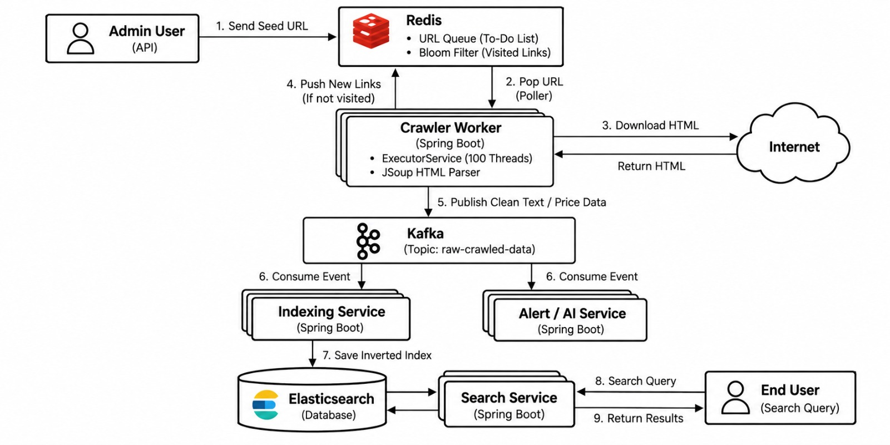

# Distributed Web Crawler & Search Platform

A distributed, event-driven web crawling and full-text search platform built to ingest, process, and search web content at scale.

---

## 1. Project Goal & Motivation

### What Are We Trying to Achieve?
The web is massive, unstructured, and constantly evolving. Searching and extracting insights from the internet requires an autonomous system that can:

1. **Ingest & Discover Content Continuously**: Start from seed URLs, follow hyperlinks recursively across domains, and discover new pages dynamically without getting trapped in cycles.
2. **Prevent Redundant Work (Deduplication)**: Avoid re-crawling millions of duplicate URLs or overwhelming target hosts.
3. **Decouple Crawling from Processing**: Separate network-bound HTML downloads from CPU-bound parsing and storage pipelines so neither creates backpressure on the other.
4. **Deliver Sub-Second Search**: Index web pages into an inverted index database to enable immediate, relevant keyword searches across millions of documents.
5. **Support Multi-Consumer Architecture**: Allow parsed crawl data to feed not just search indexing, but also downstream consumers like AI pipelines, price monitoring, or anomaly alert services.

---

## 2. High-Level Design (HLD)

The system is decomposed into four independent layers — **URL Frontier**, **Crawling & Extraction**, **Event Streaming**, and **Search & Retrieval** — each communicating asynchronously to prevent backpressure and enable independent scaling.



> **Architecture Summary:** An Admin submits a seed URL → Redis manages the URL queue and deduplication → Crawler Workers fetch HTML and extract links → Kafka decouples crawl output from downstream consumers → Indexing Service writes to Elasticsearch → Search Service answers end-user queries in milliseconds.

---

## 3. Step-by-Step Data Flow

| Step | Stage | What Happens |
|:---:|---|---|
| **1** | **Seed Submission** | An administrator submits a root target URL (e.g., `https://example.com`) to begin a crawl job. |
| **2** | **URL Frontier Check** | The URL is normalized. Redis checks the visited filter (Deduplication Set). If unvisited, it is pushed to the pending URL queue. |
| **3** | **Poller & Fetch** | Worker threads poll pending URLs from Redis, fetch the HTML document over HTTP with timeout and size guards, and parse the DOM using JSoup. |
| **4** | **Link Extraction & Feedback** | Hyperlinks (`<a href>`) are extracted from the page, converted to absolute URLs, normalized, and pushed back to the Redis URL Frontier for subsequent crawl rounds. |
| **5** | **Event Publishing** | Extracted page content (URL, title, cleaned body text, status code, timestamp, and discovered links) is published as a message to Apache Kafka. |
| **6** | **Decoupled Consumption** | Downstream consumers subscribe to the Kafka topic independently: <br>• **Indexing Service**: Consumes crawl results for search indexing.<br>• **AI / Analytics Services**: Can concurrently consume the stream for NLP, price monitoring, or sentiment analysis without impacting crawler speed. |
| **7** | **Inverted Indexing** | The Indexing Service computes a deterministic SHA-256 fingerprint for each URL and stores the document in Elasticsearch, updating the full-text inverted index. |
| **8 & 9** | **Search & Retrieval** | An end user enters a search query. The Search Service queries Elasticsearch with boolean criteria across titles and contents, returning ranked results in milliseconds. |

---

## 4. Key Architectural Decisions

### Why Redis for the URL Frontier?
- **Atomic Operations**: Redis provides atomic `SADD` (membership check) and `RPUSH`/`LPOP` operations, guaranteeing that URLs are never crawled simultaneously by multiple threads.
- **In-Memory Speed**: Sub-millisecond queue operations ensure that hundreds of worker threads never block waiting for their next crawl target.

### Why Kafka for Crawled Data?
- **Backpressure Isolation**: Network downloading speeds fluctuate independently of search indexing speeds. Kafka buffers burst crawl traffic safely.
- **Multi-Consumer Extensibility**: By decoupling extraction from storage, the same raw crawl stream can power Elasticsearch indexing, machine learning training datasets, and price alerting engines simultaneously without altering crawler code.
- **Fault Tolerance & Replayability**: If the search cluster undergoes maintenance, crawl results persist safely in Kafka and resume indexing once the database recovers.

### Why Elasticsearch for Storage?
- **Inverted Indexing**: Relational databases struggle with full-text queries across web content. Elasticsearch tokenizes text, performs stemming, and ranks hits using BM25 relevance scoring.
- **Horizontal Scalability**: Sharding and replica architecture allows searching across millions of documents with near-zero latency.

---

## 5. Technology Stack

- **Application Framework**: Spring Boot 4.1.1 (Java 21)
- **Serialization**: Jackson 3.x (`tools.jackson`)
- **HTML Parsing**: JSoup
- **URL Frontier & Deduplication**: Redis 8
- **Message Streaming**: Apache Kafka 3.7 (KRaft mode)
- **Search Engine**: Elasticsearch 9.0

---

## 6. Getting Started

### 1. Launch the Infrastructure
A root [`docker-compose.yml`](file:///f:/WebCrawler/docker-compose.yml) manages Redis, Kafka, and Elasticsearch:

```powershell
docker compose up -d
```

### 2. Run the Microservices
Run each service using its Gradle wrapper:

```powershell
# Admin Service — Port 8081
cd admin-service; .\gradlew.bat bootRun

# Crawler Worker Daemon
cd crawler-service; .\gradlew.bat bootRun

# Indexing Service — Port 8082
cd indexing-service; .\gradlew.bat bootRun

# Search Service — Port 8083
cd search-service; .\gradlew.bat bootRun
```

### 3. Run the Test Suite
The project includes unit, web slice, and live integration tests for every service:

```powershell
cd admin-service;    .\gradlew.bat test --no-daemon
cd crawler-service;  .\gradlew.bat test --no-daemon
cd indexing-service; .\gradlew.bat test --no-daemon
cd search-service;   .\gradlew.bat test --no-daemon
```
